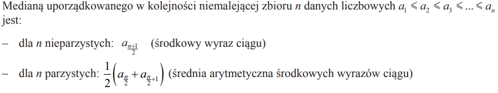
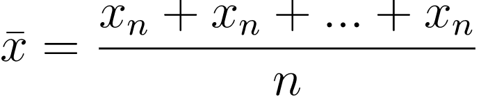
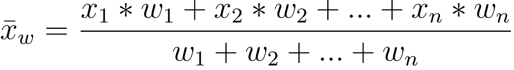
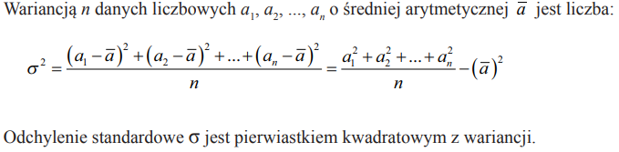

<a name="main"></a>
<h1 align="center"> Dodatkowe algorytmy </h1>

1. __algorytmy numeryczne__

   - ![py] ![noc++] ![nojava] [Suma liczb od a do b](#suma)
   - ![py] ![noc++] ![nojava] [Iloczyn liczb od a do b](#iloczyn)
   - ![py] ![noc++] ![nojava] [Czy liczba jest parzysta](#even)
   - ![py] ![noc++] ![nojava] [Czy liczba jest podzielna przez n bez reszty](#n)
   - ![py] ![noc++] ![nojava] [Czy liczba jest wielokrotnością n](#multiple)
   - ![py] ![noc++] ![nojava] [Największy i najmniejszy element w zbiorze](#minmax)
   - ![py] ![noc++] ![nojava] [Moc liczby (potęgowanie)](#potega)

2. __algorytmy arytmetyczne__

   - ![py] ![noc++] ![nojava] [Silnia (n)](#factorial)
   - ![py] ![noc++] ![nojava] [Pierwiastek kwadratowy](#sqrt)
   - ![py] ![noc++] ![nojava] [Pierwiastek n-tego stopnia](#sqrt2)
   - ![py] ![noc++] ![nojava] [Moda](#moda)
   - ![py] ![noc++] ![nojava] [Mediana](#med)
   - ![py] ![noc++] ![nojava] [Średnia arytmetyczna](#ary)
   - ![py] ![noc++] ![nojava] [Średnia ważona](#waz)
   - ![py] ![noc++] ![nojava] [Średnia geometryczna](#geo)
   - ![py] ![noc++] ![nojava] [Wariancja i odchylenie standardowe](#odchylenie)
   - ![py] ![noc++] ![nojava] [Symbol Newtona](#newton)

3. __algorytmy na łańcuchach__

   - ![py] ![noc++] ![nojava] [Zliczanie znaków w ciągu](#znaki)
   - ![py] ![noc++] ![nojava] [Zliczanie słów w łańcuchu](#iloscslow)
   - ![py] ![noc++] ![nojava] [Wyszukiwanie najdłuższego słowa w łańcuchu](#najdluzsze)
   - ![py] ![noc++] ![nojava] [Wyszukiwanie najdłuższego wspólnego podłańcucha](#podlancuch)
   - ![py] ![noc++] ![nojava] [Wyszukiwanie najdłuższego wspólnego podciągu](#podciag)
   - ![py] ![noc++] ![nojava] [Krotność znaków w łańcuchu](#kro)
   - ![py] ![noc++] ![nojava] [Naprzemienność dużych i małych liter w tekście](#naprzemiennosc)
   - ![py] ![noc++] ![nojava] [Algorytm Manachera](#manacher)
   - ![py] ![noc++] ![nojava] [Algorytm N (naiwny)](#naiwny)
   - ![py] ![noc++] ![nojava] [Algorytm Knutha-Morrisa-Pratta](#kmp)
   - ![py] ![noc++] ![nojava] [Algorytm Boyer-Moore'a](#bm)
   - ![py] ![noc++] ![nojava] [Algorytm Galila-Seiferasa](#gs)
   - ![py] ![noc++] ![nojava] [Algorytm Karpa-Rabina](#kr)

4. __kombinatoryka__

   - ![py] ![noc++] ![nojava] [Porządek leksykograficzny](#leksykograficzny)
   - ![py] ![noc++] ![nojava] [Wyszukiwanie liczby palindromów w tekście](#palindromy)

5. __geometria__

   - ![py] ![noc++] ![nojava] [Wyznaczenie punktów przecięcia okręgu z prostą](#okrag_prosta)
   - ![py] ![noc++] ![nojava] [Wyznaczanie punktu przecięcia dwóch prostych](#przeciecie)
   - ![py] ![noc++] ![nojava] [Przynależność punktu do odcinka](#punkt_odcinek)
   - ![py] ![noc++] ![nojava] [Przynależność punktu do wielokąta](#punkt_wielokat)
   - ![py] ![noc++] ![nojava] [Środek odcinka](#srodek)
   - ![py] ![noc++] ![nojava] [Długość odcinka](#dlugosc)
   - ![py] ![noc++] ![nojava] [Znajdowanie punktu tworzącego figurę](#figura)
   - ![py] ![noc++] ![nojava] [Sprawdzanie czy proste są prostopadłe / równoległe](#proste)

## Suma liczb od a do b [⬆️](#main)
<a name="suma"></a>
<details><summary>Rozwiń</summary>

```python
def suma(a, b):
    return sum(range(a, b + 1))
```

```python
def suma(a, b):
    wynik = 0
    for i in range(a, b + 1):
        wynik += i
    return wynik
```
</details>

## Iloczyn liczb od a do b [⬆️](#main)
<a name="iloczyn"></a>
<details><summary>Rozwiń</summary>

```python
def iloczyn(a, b):
    wynik = 1
    for i in range(a, b + 1):
        wynik *= i
    return wynik
```
</details>

## Czy liczba jest parzysta [⬆️](#main)
<a name="even"></a>
<details><summary>Rozwiń</summary>

```python
def is_even(x):
    if x % 2 == 0:
        return True
    return False
```
</details>

## Czy liczba jest podzielna przez n bez reszty [⬆️](#main)
<a name="n"></a>
<details><summary>Rozwiń</summary>

```python
def divisible(x, n):
    if n == 0:  # przez zero nie dzielimy
        return False
    if x % n == 0:
        return True
    return False
```
</details>

## Czy liczba jest wielokrotnością n [⬆️](#main)
<a name="multiple"></a>
<details><summary>Rozwiń</summary>

Liczba x jest wielokrotnością n, gdy x = k * n dla pewnej liczby całkowitej k, czyli gdy x % n == 0. Jedyną wielokrotnością zera jest samo zero.

```python
def is_multiple(x, n):
    if n == 0:
        return x == 0
    if x % n == 0:
        return True
    return False


print(is_multiple(333, 3))  # True, bo 333 = 111 * 3
print(is_multiple(3, 333))  # False
```
</details>

## Największy i najmniejszy element w zbiorze [⬆️](#main)
<a name="minmax"></a>
<details><summary>Rozwiń</summary>

Przechodzimy raz po wszystkich elementach i zapamiętujemy największy oraz najmniejszy element widziany do tej pory. Dla pustej listy zwracamy None.

```python
def min_max(lista):
    if len(lista) == 0:
        return None, None
    najmniejszy = lista[0]
    najwiekszy = lista[0]
    for x in lista:
        if x < najmniejszy:
            najmniejszy = x
        if x > najwiekszy:
            najwiekszy = x
    return najmniejszy, najwiekszy


print(min_max([4, -2, 7, 7, 0]))  # (-2, 7)
```

```python
lista = [4, -2, 7, 7, 0]

print(min(lista), max(lista))  # -2 7
```
</details>

## Moc liczby (potęgowanie) [⬆️](#main)
<a name="potega"></a>
<details><summary>Rozwiń</summary>

Obliczamy a<sup>n</sup> dla całkowitego n >= 0, mnożąc a przez siebie n razy (a<sup>0</sup> = 1). Szybsze potęgowanie (w czasie log n) jest w pliku [algorytmy_wymagania.md](algorytmy_wymagania.md#fast_power).

```python
#Iterated version

def potega(a, n):
    wynik = 1
    for i in range(n):
        wynik *= a
    return wynik


print(potega(2, 10))  # 1024
```

```python
#Recursive version

def potega(a, n):
    if n == 0:
        return 1
    return a * potega(a, n - 1)


print(potega(3, 4))  # 81
```

```python
from math import pow

print(2 ** 10)      # 1024
print(pow(2, 10))   # 1024.0 (math.pow zawsze zwraca float)
print(2 ** -2)      # 0.25 (operator ** działa też dla ujemnych wykładników)
```
</details>

## Silnia (n) [⬆️](#main)
<a name="factorial"></a>
<details><summary>Rozwiń</summary>

```python
from math import factorial

print(factorial(5))
```

```python
#Iterated version

def fact(n):
    factorial = 1
    if n >= 1:
        for i in range(1, n + 1):
            factorial = factorial * i
    return factorial
```

```python
#Recursive version

def fact(n):
    if n < 0:
        return None  # silnia liczby ujemnej nie istnieje
    if n == 0:
        return 1  # 0! = 1
    return n * fact(n - 1)
```
</details>

## Pierwiastek kwadratowy [⬆️](#main)
<a name="sqrt"></a>
<details><summary>Rozwiń</summary>

```python
from math import sqrt

print(sqrt(4))
```

```python
# sqrt1(liczba) - pierwiastek kwadratowy jako potęga 1/2, dla liczba >= 0

def sqrt1(x):
    return x ** (1 / 2)


print(sqrt1(4))  # 2.0
```
</details>

## Pierwiastek n-tego stopnia [⬆️](#main)
<a name="sqrt2"></a>
<details><summary>Rozwiń</summary>

Pierwiastek stopnia p to potęga 1/p. Dla liczb ujemnych i nieparzystego p liczymy pierwiastek z -x i zmieniamy znak (samo `x ** (1/p)` dałoby liczbę zespoloną). Wynik jest przybliżony, np. `27 ** (1/3)` to 3.0000000000000004.

```python
# sqrt1(liczba, stopien)

def sqrt1(x, p):
    if x < 0 and p % 2 == 1:
        return -((-x) ** (1 / p))
    return x ** (1 / p)


print(sqrt1(16, 4))  # 2.0
print(sqrt1(-8, 3))  # -2.0
```
</details>

## Moda/dominanta [⬆️](#main)
<a name="moda"></a>
<details><summary>Rozwiń</summary>

Moda to wartość występująca w liście najczęściej. Jeżeli kilka wartości występuje tyle samo razy, wszystkie wersje poniżej zwracają tę, która pojawia się w liście najwcześniej (gdy wszystkie elementy są różne, będzie to pierwszy element). Dla pustej listy zwracamy None.

```python
from collections import Counter

lista = [1, 2, 3, 2, 5]


def moda(lista):
    if len(lista) == 0:
        return None
    return Counter(lista).most_common(1)[0][0]


print(moda(lista))  # 2
```

```python
def moda(lista):
    if len(lista) == 0:
        return None
    return max(lista, key=lista.count)
```

```python
# Na teorię
def moda2(T):
    maxi = 0
    moda = None
    n = len(T)
    for i in range(n):
        count = 0
        for j in range(n):
            if T[i] == T[j]:
                count += 1
        if count > maxi:
            maxi = count
            moda = T[i]
    return moda
```
</details>

## Mediana [⬆️](#main)
<a name="med"></a>
<details><summary>Rozwiń</summary>

Sortujemy kopię listy (żeby nie zmieniać listy podanej do funkcji) i bierzemy środkowy element, a przy parzystej liczbie elementów średnią dwóch środkowych.

```python
def mediana(lista):
    lista = lista[:]  # kopia - oryginalna lista zostaje bez zmian
    for i in range(len(lista)):
        for j in range(len(lista) - i - 1):
            if lista[j] > lista[j + 1]:
                lista[j + 1], lista[j] = lista[j], lista[j + 1]

    n = len(lista)
    if n == 0:
        return None
    if n % 2 == 0:
        mediana = (lista[n // 2 - 1] + lista[n // 2]) / 2
    else:
        mediana = lista[n // 2]
    return mediana


print(mediana([5, 1, 4, 2]))  # 3.0
```

### Ze wzoru:

</details>

## Średnia arytmetyczna [⬆️](#main)
<a name="ary"></a>
<details><summary>Rozwiń</summary>

```python
def srednia(x):
    return sum(x) / len(x)
```

```python
def srednia(x):
    count = 0
    licznik = 0
    for i in range(len(x)):
        count += 1
        licznik += x[i]
    return licznik / count
```

### Ze wzoru:

</details>

## Średnia ważona [⬆️](#main)
<a name="waz"></a>
<details><summary>Rozwiń</summary>

```python
def srednia(lista, wagi):
    wynik = sum(i * j for i, j in zip(lista, wagi)) / sum(wagi)
    return wynik
```

```python
def srednia(lista, wagi):
    wynik_wagi = 0
    wynik = 0
    for i in range(len(wagi)):
        wynik_wagi += wagi[i]
        wynik += lista[i] * wagi[i]
    return wynik / wynik_wagi
```

### Ze wzoru:

</details>

## Średnia geometryczna [⬆️](#main)
<a name="geo"></a>
<details><summary>Rozwiń</summary>

Średnią geometryczną liczymy dla liczb dodatnich.

```python
def srednia(lista):
    if len(lista) == 0:
        return None
    wynik = 1
    for i in lista:
        wynik *= i
    wynik = wynik ** (1 / len(lista))
    return wynik


print(srednia([2, 8]))  # 4.0
```

### Ze wzoru:

</details>

## Wariancja i odchylenie standardowe [⬆️](#main)
<a name="odchylenie"></a>
<details><summary>Rozwiń</summary>

Wariancja to średnia z kwadratów minus kwadrat średniej (wariancja populacji, dzielimy przez n). Odchylenie standardowe to pierwiastek z wariancji.

```python
def wariancja(lista):
    return sum(i ** 2 for i in lista) / len(lista) - (sum(lista) / len(lista)) ** 2
```

```python
def srednia(x):
    count = 0
    licznik = 0
    for i in range(len(x)):
        count += 1
        licznik += x[i]
    return licznik / count


def wariancja2(lista):
    n = 0
    suma = 0
    for i in range(len(lista)):
        n += 1
        suma += lista[i] ** 2
    return suma / n - srednia(lista) ** 2
```

```python
# Z definicji: średnia kwadratów odchyleń od średniej (dokładniejsze dla liczb zmiennoprzecinkowych)
from math import sqrt


def wariancja3(lista):
    sr = sum(lista) / len(lista)
    suma = 0
    for x in lista:
        suma += (x - sr) ** 2
    return suma / len(lista)


def odchylenie(lista):
    return sqrt(wariancja3(lista))


print(wariancja3([2, 4, 4, 4, 5, 5, 7, 9]))  # 4.0
print(odchylenie([2, 4, 4, 4, 5, 5, 7, 9]))  # 2.0
```

### Ze wzoru:

</details>

## Symbol Newtona [⬆️](#main)
<a name="newton"></a>
<details><summary>Rozwiń</summary>

Symbol Newtona (n po k) to liczba sposobów wybrania k elementów z n elementów: n! / (k! * (n - k)!). Wersja iteracyjna nie liczy silni, tylko mnoży i dzieli na zmianę: po i-tym kroku wynik to (n-k+i po i), więc dzielenie `//` jest zawsze dokładne.

```python
#Iterated version

def newton(n, k):
    if k < 0 or k > n:
        return 0
    if k > n - k:
        k = n - k  # (n po k) = (n po n-k), mniej mnożeń
    wynik = 1
    for i in range(1, k + 1):
        wynik = wynik * (n - k + i) // i
    return wynik


print(newton(5, 2))  # 10
```

```python
#Recursive version (trójkąt Pascala) - wolna dla dużych n

def newton(n, k):
    if k < 0 or k > n:
        return 0
    if k == 0 or k == n:
        return 1
    return newton(n - 1, k - 1) + newton(n - 1, k)


print(newton(5, 2))  # 10
```

```python
from math import comb

print(comb(5, 2))  # 10
```
</details>

## Zliczanie znaków w ciągu [⬆️](#main)
<a name="znaki"></a>
<details><summary>Rozwiń</summary>

```python
tekst = "Ala ma 2 koty"

print(len(tekst))        # 13 - wszystkie znaki (razem ze spacjami)
print(tekst.count("a"))  # 2 - ile razy występuje mała litera "a"
```

```python
def ile_znakow(tekst, znak):
    licznik = 0
    for z in tekst:
        if z == znak:
            licznik += 1
    return licznik


def rodzaje_znakow(tekst):
    litery = 0
    cyfry = 0
    spacje = 0
    for z in tekst:
        if z.isalpha():
            litery += 1
        elif z.isdigit():
            cyfry += 1
        elif z == " ":
            spacje += 1
    return litery, cyfry, spacje


print(ile_znakow("Ala ma 2 koty", "a"))  # 2
print(rodzaje_znakow("Ala ma 2 koty"))   # (9, 1, 3)
```
</details>

## Zliczanie słów w łańcuchu [⬆️](#main)
<a name="iloscslow"></a>
<details><summary>Rozwiń</summary>

```python
slowo = "Ala ma kota"
i = len(slowo.split())

print(i)
```
</details>

## Wyszukiwanie najdłuższego słowa w łańcuchu [⬆️](#main)
<a name="najdluzsze"></a>
<details><summary>Rozwiń</summary>

Dzielimy tekst na słowa i zapamiętujemy najdłuższe. Przy kilku słowach tej samej długości zwracamy pierwsze z nich.

```python
def najdluzsze_slowo(tekst):
    najdluzsze = ""
    for slowo in tekst.split():
        if len(slowo) > len(najdluzsze):
            najdluzsze = slowo
    return najdluzsze


print(najdluzsze_slowo("Ala ma bardzo ładnego kota"))  # ładnego
```

```python
tekst = "Ala ma bardzo ładnego kota"

print(max(tekst.split(), key=len))  # ładnego
```
</details>

## Wyszukiwanie najdłuższego wspólnego podłańcucha [⬆️](#main)
<a name="podlancuch"></a>
<details><summary>Rozwiń</summary>

Podłańcuch to spójny fragment tekstu. W tablicy `dp[i][j]` zapisujemy długość najdłuższego wspólnego fragmentu kończącego się na znaku a[i-1] i na znaku b[j-1]. Czas O(n * m).

```python
def najdluzszy_wspolny_podlancuch(a, b):
    n = len(a)
    m = len(b)
    dp = [[0] * (m + 1) for i in range(n + 1)]
    najdluzszy = 0
    koniec = 0  # indeks w a tuż za końcem najlepszego fragmentu
    for i in range(1, n + 1):
        for j in range(1, m + 1):
            if a[i - 1] == b[j - 1]:
                dp[i][j] = dp[i - 1][j - 1] + 1
                if dp[i][j] > najdluzszy:
                    najdluzszy = dp[i][j]
                    koniec = i
    return a[koniec - najdluzszy:koniec]


print(najdluzszy_wspolny_podlancuch("informatyka", "matematyka"))  # matyka
```
</details>

## Wyszukiwanie najdłuższego wspólnego podciągu [⬆️](#main)
<a name="podciag"></a>
<details><summary>Rozwiń</summary>

Podciąg (LCS) nie musi być spójny - powstaje przez usunięcie niektórych znaków. `dp[i][j]` to długość LCS dla a[:i] i b[:j]. Sam podciąg odczytujemy, cofając się po tablicy od `dp[n][m]`.

```python
def najdluzszy_wspolny_podciag(a, b):
    n = len(a)
    m = len(b)
    dp = [[0] * (m + 1) for i in range(n + 1)]
    for i in range(1, n + 1):
        for j in range(1, m + 1):
            if a[i - 1] == b[j - 1]:
                dp[i][j] = dp[i - 1][j - 1] + 1
            else:
                dp[i][j] = max(dp[i - 1][j], dp[i][j - 1])

    # odtwarzanie podciągu od końca
    wynik = ""
    i = n
    j = m
    while i > 0 and j > 0:
        if a[i - 1] == b[j - 1]:
            wynik = a[i - 1] + wynik
            i -= 1
            j -= 1
        elif dp[i - 1][j] >= dp[i][j - 1]:
            i -= 1
        else:
            j -= 1
    return wynik


print(najdluzszy_wspolny_podciag("ABCBDAB", "BDCABA"))  # BCBA (długość 4)
```
</details>

## Krotność znaków w łańcuchu [⬆️](#main)
<a name="kro"></a>
<details><summary>Rozwiń</summary>

```python
from collections import Counter

tekst = "nie zdam matury"
print(Counter(tekst))  # ile razy występuje każdy znak

lista_slow = ["nie", "zdam", "nie", "matury"]
print(Counter(lista_slow))  # ile razy występuje każde słowo
```

```python
def krotnosc(tekst):
    slownik = {}
    for znak in tekst:
        if znak in slownik:
            slownik[znak] += 1
        else:
            slownik[znak] = 1
    return slownik


print(krotnosc("slowo"))  # {'s': 1, 'l': 1, 'o': 2, 'w': 1}
```
</details>

## Naprzemienność dużych i małych liter w tekście [⬆️](#main)
<a name="naprzemiennosc"></a>
<details><summary>Rozwiń</summary>

Sprawdzamy, czy kolejne litery (pomijając spacje, cyfry i inne znaki) są na zmianę wielkie i małe. Druga funkcja zamienia tekst na taki zapis.

```python
def czy_naprzemienne(tekst):
    poprzednia_wielka = None  # jeszcze nie było żadnej litery
    for znak in tekst:
        if znak.isalpha():
            wielka = znak.isupper()
            if wielka == poprzednia_wielka:
                return False
            poprzednia_wielka = wielka
    return True


def na_naprzemienne(tekst, od_wielkiej=False):
    wynik = ""
    wielka = od_wielkiej
    for znak in tekst:
        if znak.isalpha():
            if wielka:
                wynik += znak.upper()
            else:
                wynik += znak.lower()
            wielka = not wielka
        else:
            wynik += znak
    return wynik


print(czy_naprzemienne("AlA mA kOtA"))   # True
print(czy_naprzemienne("Ala ma kota"))   # False
print(na_naprzemienne("nie zdam matury"))  # nIe ZdAm MaTuRy
```
</details>

## Algorytm Manachera [⬆️](#main)
<a name="manacher"></a>
<details><summary>Rozwiń</summary>

Znajduje najdłuższy podłańcuch będący palindromem w czasie O(n). Między litery wstawiamy znak `#`, dzięki czemu palindromy parzystej i nieparzystej długości liczymy tak samo. `promien[i]` to długość palindromu (w oryginalnym tekście) o środku w i; wykorzystujemy symetrię względem środka najdalej sięgającego palindromu, żeby nie porównywać znaków od nowa.

```python
def manacher(tekst):
    if tekst == "":
        return ""
    t = "#" + "#".join(tekst) + "#"
    n = len(t)
    promien = [0] * n
    srodek = 0
    prawy = 0  # prawy koniec najdalej sięgającego palindromu
    for i in range(n):
        if i < prawy:
            promien[i] = min(prawy - i, promien[2 * srodek - i])
        while (i - promien[i] - 1 >= 0 and i + promien[i] + 1 < n
               and t[i - promien[i] - 1] == t[i + promien[i] + 1]):
            promien[i] += 1
        if i + promien[i] > prawy:
            srodek = i
            prawy = i + promien[i]

    najlepszy = 0
    for i in range(n):
        if promien[i] > promien[najlepszy]:
            najlepszy = i
    poczatek = (najlepszy - promien[najlepszy]) // 2
    return tekst[poczatek:poczatek + promien[najlepszy]]


print(manacher("abacdfgdcabba"))  # abba
print(manacher("babcbabcbaccba"))  # abcbabcba
```
</details>

## Algorytm N (naiwny) [⬆️](#main)
<a name="naiwny"></a>
<details><summary>Rozwiń</summary>

Przykładamy wzorzec do każdej pozycji tekstu i porównujemy znak po znaku. Zwracamy listę wszystkich pozycji (także nachodzących na siebie). Czas O(n * m).

```python
def naiwny(tekst, wzorzec):
    wyniki = []
    n = len(tekst)
    m = len(wzorzec)
    if m == 0:
        return wyniki
    for i in range(n - m + 1):
        j = 0
        while j < m and tekst[i + j] == wzorzec[j]:
            j += 1
        if j == m:
            wyniki.append(i)
    return wyniki


print(naiwny("abababa", "aba"))  # [0, 2, 4]
```
</details>

## Algorytm Knutha-Morrisa-Pratta [⬆️](#main)
<a name="kmp"></a>
<details><summary>Rozwiń</summary>

Najpierw liczymy funkcję prefiksową: `pi[i]` to długość najdłuższego właściwego prefiksu wzorca, który jest też sufiksem `wzorzec[:i+1]`. Przy niezgodności nie cofamy się w tekście, tylko skracamy dopasowanie do `pi[k-1]`. Czas O(n + m).

```python
def funkcja_prefiksowa(wzorzec):
    m = len(wzorzec)
    pi = [0] * m
    k = 0
    for i in range(1, m):
        while k > 0 and wzorzec[i] != wzorzec[k]:
            k = pi[k - 1]
        if wzorzec[i] == wzorzec[k]:
            k += 1
        pi[i] = k
    return pi


def kmp(tekst, wzorzec):
    wyniki = []
    m = len(wzorzec)
    if m == 0:
        return wyniki
    pi = funkcja_prefiksowa(wzorzec)
    k = 0  # ile znaków wzorca jest aktualnie dopasowanych
    for i in range(len(tekst)):
        while k > 0 and tekst[i] != wzorzec[k]:
            k = pi[k - 1]
        if tekst[i] == wzorzec[k]:
            k += 1
        if k == m:
            wyniki.append(i - m + 1)
            k = pi[k - 1]
    return wyniki


print(funkcja_prefiksowa("ababaca"))  # [0, 0, 1, 2, 3, 0, 1]
print(kmp("abababa", "aba"))          # [0, 2, 4]
```
</details>

## Algorytm Boyer-Moore'a [⬆️](#main)
<a name="bm"></a>
<details><summary>Rozwiń</summary>

Wzorzec porównujemy od prawej do lewej. Po niezgodności przesuwamy wzorzec o większą z dwóch wartości:
- reguła złego znaku - ustawiamy pod niezgodnym znakiem tekstu jego ostatnie wystąpienie we wzorcu,
- reguła dobrego sufiksu - dopasowany już koniec wzorca ustawiamy pod jego kolejnym wystąpieniem we wzorcu (albo pod pasującym prefiksem).

```python
def zly_znak(wzorzec):
    ostatnie = {}  # ostatnia pozycja każdego znaku we wzorcu
    for i in range(len(wzorzec)):
        ostatnie[wzorzec[i]] = i
    return ostatnie


def dobry_sufiks(wzorzec):
    m = len(wzorzec)
    przesuniecie = [0] * (m + 1)
    granica = [0] * (m + 1)
    i = m
    j = m + 1
    granica[i] = j
    while i > 0:
        while j <= m and wzorzec[i - 1] != wzorzec[j - 1]:
            if przesuniecie[j] == 0:
                przesuniecie[j] = j - i
            j = granica[j]
        i -= 1
        j -= 1
        granica[i] = j
    j = granica[0]
    for i in range(m + 1):
        if przesuniecie[i] == 0:
            przesuniecie[i] = j
        if i == j:
            j = granica[j]
    return przesuniecie


def boyer_moore(tekst, wzorzec):
    wyniki = []
    n = len(tekst)
    m = len(wzorzec)
    if m == 0:
        return wyniki
    ostatnie = zly_znak(wzorzec)
    przesuniecie = dobry_sufiks(wzorzec)
    s = 0  # pozycja wzorca w tekście
    while s <= n - m:
        j = m - 1
        while j >= 0 and wzorzec[j] == tekst[s + j]:
            j -= 1
        if j < 0:
            wyniki.append(s)
            s += przesuniecie[0]
        else:
            o_zly_znak = j - ostatnie.get(tekst[s + j], -1)
            s += max(przesuniecie[j + 1], o_zly_znak)
    return wyniki


print(boyer_moore("abababa", "aba"))          # [0, 2, 4]
print(boyer_moore("nie zdam matury", "matury"))  # [9]
```
</details>

## Algorytm Galila-Seiferasa [⬆️](#main)
<a name="gs"></a>
<details><summary>Rozwiń</summary>

Algorytm działa w czasie O(n + m) i potrzebuje tylko kilku zmiennych dodatkowej pamięci. Wzorzec jest dzielony na krótki początek u (długości s) i resztę v, w której nie ma długich powtórzeń; najpierw szukamy v, a dopiero potem sprawdzamy u. Kod jest przeniesieniem implementacji w C z książki C. Charras, T. Lecroq "Exact String Matching Algorithms" (stała k = 4). Tam funkcje newP1, newP2, parse i search wywołują się nawzajem - tutaj zamiast tego zmienna `krok` mówi, która część ma się wykonać. Na maturze raczej się nie pojawi.

```python
def galil_seiferas(tekst, wzorzec):
    wyniki = []
    n = len(tekst)
    m = len(wzorzec)
    if m == 0 or m > n:
        return wyniki
    x = list(wzorzec) + [None]  # strażnik na końcu (w C: znak '\0')
    y = tekst
    k = 4
    p = q = s = q1 = p2 = q2 = 0
    p1 = 1
    krok = "newP1"
    while True:
        if krok == "newP1":
            while x[s + q1] == x[s + p1 + q1]:
                q1 += 1
            if p1 + q1 >= k * p1:
                p2 = q1
                q2 = 0
                krok = "newP2"
            elif s + p1 + q1 == m:
                krok = "search"
            else:
                p1 += q1 // k + 1
                q1 = 0

        elif krok == "newP2":
            while x[s + q2] == x[s + p2 + q2] and p2 + q2 < k * p2:
                q2 += 1
            if p2 + q2 == k * p2:
                krok = "parse"
            elif s + p2 + q2 == m:
                krok = "search"
            elif q2 == p1 + q1:
                p2 += p1
                q2 -= p1
            else:
                p2 += q2 // k + 1
                q2 = 0

        elif krok == "parse":
            while True:
                while x[s + q1] == x[s + p1 + q1]:
                    q1 += 1
                while p1 + q1 >= k * p1:
                    s += p1
                    q1 -= p1
                p1 += q1 // k + 1
                q1 = 0
                if p1 >= p2:
                    break
            krok = "newP1"

        else:  # krok == "search" - właściwe wyszukiwanie w tekście
            while p <= n - m:
                while p + s + q < n and x[s + q] == y[p + s + q]:
                    q += 1
                if q == m - s and y[p:p + s + 1] == wzorzec[:s + 1]:
                    wyniki.append(p)
                if q == p1 + q1:
                    p += p1
                    q -= p1
                else:
                    p += q // k + 1
                    q = 0
            return wyniki


print(galil_seiferas("abababa", "aba"))  # [0, 2, 4]
print(galil_seiferas("aaaaa", "aa"))     # [0, 1, 2, 3]
```
</details>

## Algorytm Karpa-Rabina [⬆️](#main)
<a name="kr"></a>
<details><summary>Rozwiń</summary>

Zamiast porównywać napisy, porównujemy ich hasze (liczby). Hasz okna tekstu przesuniętego o jeden znak liczymy z poprzedniego w czasie O(1) (hasz "toczący się"): odejmujemy pierwszy znak i dopisujemy nowy. Gdy hasze są równe, sprawdzamy jeszcze napis, bo różne napisy mogą mieć ten sam hasz.

```python
def karp_rabin(tekst, wzorzec):
    wyniki = []
    n = len(tekst)
    m = len(wzorzec)
    if m == 0 or m > n:
        return wyniki
    B = 256            # podstawa
    P = 1000000007     # duża liczba pierwsza (modulo)
    hasz_wzorca = 0
    hasz_okna = 0
    for i in range(m):
        hasz_wzorca = (hasz_wzorca * B + ord(wzorzec[i])) % P
        hasz_okna = (hasz_okna * B + ord(tekst[i])) % P
    najwyzsza = pow(B, m - 1, P)  # B^(m-1) % P

    for i in range(n - m + 1):
        if hasz_okna == hasz_wzorca and tekst[i:i + m] == wzorzec:
            wyniki.append(i)
        if i < n - m:  # przesuwamy okno o jeden znak w prawo
            hasz_okna = (hasz_okna - ord(tekst[i]) * najwyzsza) % P
            hasz_okna = (hasz_okna * B + ord(tekst[i + m])) % P
    return wyniki


print(karp_rabin("abababa", "aba"))  # [0, 2, 4]
```
</details>

## Porządek leksykograficzny [⬆️](#main)
<a name="leksykograficzny"></a>
<details><summary>Rozwiń</summary>

Porządek leksykograficzny to kolejność "słownikowa": porównujemy pierwsze różniące się elementy, a jeśli jeden ciąg jest początkiem drugiego, krótszy jest wcześniej. Python porównuje znaki według kodów, więc polskie litery (ą, ć, ...) są po "z".

```python
def porownaj(a, b):  # -1 gdy a < b, 0 gdy a == b, 1 gdy a > b
    for i in range(min(len(a), len(b))):
        if a[i] < b[i]:
            return -1
        if a[i] > b[i]:
            return 1
    if len(a) < len(b):
        return -1
    if len(a) > len(b):
        return 1
    return 0


print(porownaj("kot", "kotek"))  # -1
print(porownaj("kura", "kot"))   # 1
print("kot" < "kotek")           # True - Python porównuje tak samo
```

Kolejna permutacja w porządku leksykograficznym: od końca szukamy pierwszego i, dla którego t[i] < t[i+1], zamieniamy t[i] z najmniejszym większym od niego elementem z prawej strony, a końcówkę odwracamy. Zaczynając od ciągu posortowanego, dostajemy wszystkie permutacje po kolei (przy powtórzeniach - każdą tylko raz).

```python
def nastepna_permutacja(t):
    t = list(t)
    i = len(t) - 2
    while i >= 0 and t[i] >= t[i + 1]:
        i -= 1
    if i < 0:
        return None  # to była ostatnia permutacja
    j = len(t) - 1
    while t[j] <= t[i]:
        j -= 1
    t[i], t[j] = t[j], t[i]
    t[i + 1:] = t[i + 1:][::-1]
    return t


def wszystkie_permutacje(elementy):
    wynik = []
    t = sorted(elementy)
    while t is not None:
        wynik.append("".join(t))
        t = nastepna_permutacja(t)
    return wynik


print(wszystkie_permutacje("abc"))  # ['abc', 'acb', 'bac', 'bca', 'cab', 'cba']
```

```python
from itertools import permutations

for p in permutations(sorted("abc")):  # dla posortowanych danych kolejność jest leksykograficzna
    print("".join(p))
```
</details>

## Wyszukiwanie liczby palindromów w tekście [⬆️](#main)
<a name="palindromy"></a>
<details><summary>Rozwiń</summary>

Liczymy wszystkie podłańcuchy będące palindromami (każde wystąpienie osobno, również pojedyncze litery), np. "aaa" ma 6 palindromów: a, a, a, aa, aa, aaa.

```python
# Na teorię - sprawdzamy każdy podłańcuch, O(n^3)
def liczba_palindromow(tekst):
    licznik = 0
    n = len(tekst)
    for i in range(n):
        for j in range(i + 1, n + 1):
            fragment = tekst[i:j]
            if fragment == fragment[::-1]:
                licznik += 1
    return licznik


print(liczba_palindromow("aaa"))  # 6
```

Szybciej (O(n^2)): każdy palindrom ma środek - literę albo miejsce między dwiema literami. Dla każdego z 2n - 1 środków rozszerzamy palindrom w obie strony, dopóki znaki są równe.

```python
def liczba_palindromow(tekst):
    licznik = 0
    n = len(tekst)
    for srodek in range(2 * n - 1):
        lewy = srodek // 2
        prawy = lewy + srodek % 2
        while lewy >= 0 and prawy < n and tekst[lewy] == tekst[prawy]:
            licznik += 1
            lewy -= 1
            prawy += 1
    return licznik


print(liczba_palindromow("abba"))  # 6: a, b, b, a, bb, abba
```

```python
# Ile słów w zdaniu jest palindromami (bez rozróżniania wielkości liter)
def palindromy_w_zdaniu(zdanie):
    licznik = 0
    for slowo in zdanie.split():
        slowo = slowo.lower()
        if slowo == slowo[::-1]:
            licznik += 1
    return licznik


print(palindromy_w_zdaniu("Kajak i radar to palindromy"))  # 3 (kajak, i, radar)
```
</details>

## Wyznaczenie punktów przecięcia okręgu z prostą [⬆️](#main)
<a name="okrag_prosta"></a>
<details><summary>Rozwiń</summary>

Okrąg o środku (p, q) i promieniu r: (x - p)² + (y - q)² = r². Po wstawieniu y = ax + b dostajemy równanie kwadratowe (1 + a²)x² + 2(a(b - q) - p)x + p² + (b - q)² - r² = 0. Liczba rozwiązań (0, 1 albo 2) zależy od delty. Prostej pionowej x = c nie da się zapisać jako y = ax + b, więc ma osobną funkcję.

```python
from math import sqrt

EPS = 1e-9  # tolerancja dla liczb zmiennoprzecinkowych


def przeciecie_okregu_z_prosta(a, b, p, q, r):
    # prosta y = ax + b, okrąg o środku (p, q) i promieniu r
    A = 1 + a * a
    B = 2 * (a * (b - q) - p)
    C = p * p + (b - q) ** 2 - r * r
    delta = B * B - 4 * A * C
    if delta < -EPS:
        return []  # brak punktów wspólnych
    if abs(delta) <= EPS:
        x = -B / (2 * A)
        return [(x, a * x + b)]  # prosta styczna
    x1 = (-B - sqrt(delta)) / (2 * A)
    x2 = (-B + sqrt(delta)) / (2 * A)
    return [(x1, a * x1 + b), (x2, a * x2 + b)]


def przeciecie_okregu_z_pionowa(c, p, q, r):
    # prosta pionowa x = c
    d = r * r - (c - p) ** 2
    if d < -EPS:
        return []
    if abs(d) <= EPS:
        return [(c, q)]
    return [(c, q - sqrt(d)), (c, q + sqrt(d))]


print(przeciecie_okregu_z_prosta(0, 0, 0, 0, 5))  # [(-5.0, 0.0), (5.0, 0.0)]
print(przeciecie_okregu_z_prosta(0, 5, 0, 0, 5))  # [(0.0, 5.0)]
print(przeciecie_okregu_z_pionowa(3, 0, 0, 5))    # [(3, -4.0), (3, 4.0)]
```
</details>

## Wyznaczanie punktu przecięcia dwóch prostych [⬆️](#main)
<a name="przeciecie"></a>
<details><summary>Rozwiń</summary>

Proste w postaci ogólnej A1x + B1y = C1 i A2x + B2y = C2 rozwiązujemy wzorami Cramera. Gdy wyznacznik W = 0, proste są równoległe (brak punktu) albo się pokrywają (nieskończenie wiele punktów).

```python
def przeciecie_prostych(A1, B1, C1, A2, B2, C2):
    W = A1 * B2 - A2 * B1
    Wx = C1 * B2 - C2 * B1
    Wy = A1 * C2 - A2 * C1
    if W == 0:
        if Wx == 0 and Wy == 0:
            return "proste się pokrywają"
        return "proste są równoległe"
    return (Wx / W, Wy / W)


print(przeciecie_prostych(1, 1, 2, 1, -1, 0))  # (1.0, 1.0)
print(przeciecie_prostych(1, 0, 3, 0, 1, -2))  # (3.0, -2.0) - prosta pionowa x = 3 i pozioma y = -2
print(przeciecie_prostych(1, 1, 2, 2, 2, 7))   # proste są równoległe
```

```python
# Proste w postaci y = a1*x + b1 i y = a2*x + b2
def przeciecie_prostych(a1, b1, a2, b2):
    if a1 == a2:
        if b1 == b2:
            return "proste się pokrywają"
        return "proste są równoległe"
    x = (b2 - b1) / (a1 - a2)
    return (x, a1 * x + b1)


print(przeciecie_prostych(1, 0, -1, 2))  # (1.0, 1.0)
```
</details>

## Przynależność punktu do odcinka [⬆️](#main)
<a name="punkt_odcinek"></a>
<details><summary>Rozwiń</summary>

Punkt P leży na odcinku AB, gdy iloczyn wektorowy AB × AP jest równy 0 (P leży na prostej AB) i P mieści się w prostokącie wyznaczonym przez A i B. Dla współrzędnych całkowitych wynik jest dokładny.

```python
def na_odcinku(A, B, P):
    x1, y1 = A
    x2, y2 = B
    px, py = P
    iloczyn = (x2 - x1) * (py - y1) - (y2 - y1) * (px - x1)
    if iloczyn != 0:
        return False
    return min(x1, x2) <= px <= max(x1, x2) and min(y1, y2) <= py <= max(y1, y2)


print(na_odcinku((0, 0), (4, 4), (2, 2)))  # True
print(na_odcinku((0, 0), (4, 4), (5, 5)))  # False - na prostej, ale poza odcinkiem
print(na_odcinku((0, 0), (4, 4), (2, 3)))  # False
```
</details>

## Przynależność punktu do wielokąta [⬆️](#main)
<a name="punkt_wielokat"></a>
<details><summary>Rozwiń</summary>

Metoda promienia: z punktu P prowadzimy półprostą w prawo i liczymy, ile boków wielokąta przecina. Nieparzysta liczba przecięć oznacza, że P jest w środku. Punkt leżący na boku traktujemy jako należący do wielokąta. Wierzchołki podajemy po kolei (wielokąt nie musi być wypukły).

```python
def na_odcinku(A, B, P):
    x1, y1 = A
    x2, y2 = B
    px, py = P
    iloczyn = (x2 - x1) * (py - y1) - (y2 - y1) * (px - x1)
    if iloczyn != 0:
        return False
    return min(x1, x2) <= px <= max(x1, x2) and min(y1, y2) <= py <= max(y1, y2)


def w_wielokacie(P, wielokat):
    px, py = P
    n = len(wielokat)
    wewnatrz = False
    for i in range(n):
        A = wielokat[i]
        B = wielokat[(i + 1) % n]
        if na_odcinku(A, B, P):
            return True  # punkt na brzegu
        x1, y1 = A
        x2, y2 = B
        if (y1 > py) != (y2 > py):  # bok przecina poziomą prostą y = py
            x_przeciecia = x1 + (py - y1) * (x2 - x1) / (y2 - y1)
            if px < x_przeciecia:
                wewnatrz = not wewnatrz
    return wewnatrz


kwadrat = [(0, 0), (4, 0), (4, 4), (0, 4)]
print(w_wielokacie((2, 2), kwadrat))  # True
print(w_wielokacie((4, 1), kwadrat))  # True - na brzegu
print(w_wielokacie((5, 2), kwadrat))  # False
```
</details>

## Środek odcinka [⬆️](#main)
<a name="srodek"></a>
<details><summary>Rozwiń</summary>

```python
def srodek_odcinka(A, B):
    return ((A[0] + B[0]) / 2, (A[1] + B[1]) / 2)


print(srodek_odcinka((0, 0), (4, 6)))  # (2.0, 3.0)
```
</details>

## Długość odcinka [⬆️](#main)
<a name="dlugosc"></a>
<details><summary>Rozwiń</summary>

Z twierdzenia Pitagorasa: |AB| = √((x2 - x1)² + (y2 - y1)²).

```python
from math import sqrt


def dlugosc_odcinka(A, B):
    return sqrt((B[0] - A[0]) ** 2 + (B[1] - A[1]) ** 2)


print(dlugosc_odcinka((0, 0), (3, 4)))  # 5.0
```

```python
from math import dist

print(dist((0, 0), (3, 4)))  # 5.0
```
</details>

## Znajdowanie punktu tworzącego figurę [⬆️](#main)
<a name="figura"></a>
<details><summary>Rozwiń</summary>

Mając trzy wierzchołki A, B, C równoległoboku, czwarty wierzchołek D wyznaczamy z tego, że przekątne dzielą się na pół. Są trzy możliwości, zależnie od tego, który z punktów leży naprzeciw D: D = A + C - B, D = A + B - C albo D = B + C - A.

```python
def czwarty_wierzcholek(A, B, C):
    D1 = (A[0] + C[0] - B[0], A[1] + C[1] - B[1])  # równoległobok ABCD
    D2 = (A[0] + B[0] - C[0], A[1] + B[1] - C[1])  # równoległobok ACBD
    D3 = (B[0] + C[0] - A[0], B[1] + C[1] - A[1])  # równoległobok BACD
    return [D1, D2, D3]


print(czwarty_wierzcholek((0, 0), (2, 0), (3, 2)))  # [(1, 2), (-1, -2), (5, 2)]
```

Mając dwa sąsiednie wierzchołki kwadratu A i B, obracamy wektor AB = (dx, dy) o 90° - dostajemy (-dy, dx) - i dodajemy go do A i B. Obrót w drugą stronę daje drugi kwadrat.

```python
def kwadrat(A, B):
    dx = B[0] - A[0]
    dy = B[1] - A[1]
    C1 = (B[0] - dy, B[1] + dx)
    D1 = (A[0] - dy, A[1] + dx)
    C2 = (B[0] + dy, B[1] - dx)
    D2 = (A[0] + dy, A[1] - dx)
    return [(C1, D1), (C2, D2)]  # dwa możliwe kwadraty ABCD


print(kwadrat((0, 0), (2, 0)))  # [((2, 2), (0, 2)), ((2, -2), (0, -2))]
```
</details>

## Sprawdzanie czy proste są prostopadłe / równoległe [⬆️](#main)
<a name="proste"></a>
<details><summary>Rozwiń</summary>

Dla prostych y = a1x + b1 i y = a2x + b2: równoległe, gdy a1 = a2, prostopadłe, gdy a1 * a2 = -1. Dla postaci ogólnej Ax + By + C = 0 (obejmuje też proste pionowe): równoległe, gdy A1 * B2 - A2 * B1 = 0, prostopadłe, gdy A1 * A2 + B1 * B2 = 0.

```python
EPS = 1e-9  # współczynniki mogą być ułamkami, np. 1/3


def rownolegle(a1, a2):
    return abs(a1 - a2) < EPS


def prostopadle(a1, a2):
    return abs(a1 * a2 + 1) < EPS


print(rownolegle(2, 2))      # True
print(prostopadle(2, -0.5))  # True
print(prostopadle(3, -1 / 3))  # True
```

```python
# Postać ogólna A*x + B*y + C = 0
def rownolegle(A1, B1, A2, B2):
    return A1 * B2 - A2 * B1 == 0


def prostopadle(A1, B1, A2, B2):
    return A1 * A2 + B1 * B2 == 0


print(rownolegle(1, 0, 2, 0))   # True - dwie proste pionowe x = ...
print(prostopadle(1, 0, 0, 1))  # True - pionowa i pozioma
print(prostopadle(2, -1, 1, 2)) # True - y = 2x i y = -x/2
```
</details>


[py]: https://img.shields.io/badge/Python-%E2%9C%94-green?style=flat-square&logo=python
[nopy]: https://img.shields.io/badge/Python-%E2%9C%98-red?style=flat-square&logo=python

[java]: https://img.shields.io/badge/Java-%E2%9C%94-green?style=flat-square&logo=Java&logoColor=yellow
[nojava]: https://img.shields.io/badge/Java-%E2%9C%98-red?style=flat-square&logo=Java&logoColor=yellow

[c++]: https://img.shields.io/badge/C++-%E2%9C%94-green?style=flat-square&logo=c%2B%2B&logoColor=blue
[noc++]: https://img.shields.io/badge/C++-%E2%9C%98-red?style=flat-square&logo=c%2B%2B&logoColor=blue 
